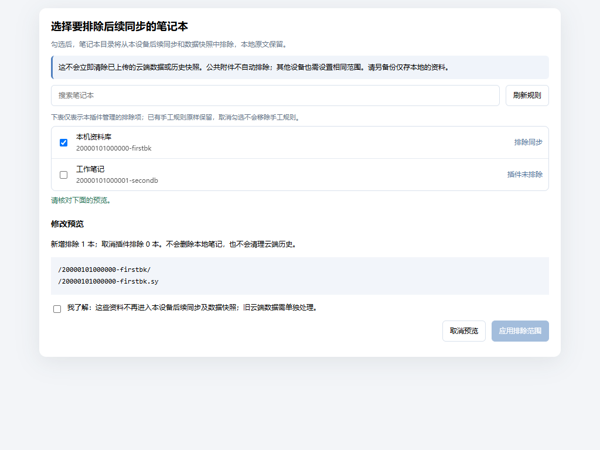

# 指定同步范围

按笔记本管理本设备的同步排除范围。



## 为什么做这个插件

我导入了一份体积较大的中医笔记，结果云端同步空间不够用了。有些资料只需要留在当前电脑上，其他笔记又希望继续同步，所以做了这个插件，把思源的同步忽略规则变成可以按笔记本勾选、预览和应用的界面。

这份资料来自链滴的[《分享自己这么多年来用思源做的中医笔记》](https://ld246.com/article/1792580522977)。楼主主动分享了多年整理的中医笔记，希望能帮助到其他人，也在这里推荐给有需要的朋友。资料内容和获取说明请到原帖查看；本插件只附来源链接，安装包不包含这份中医笔记。

示例图使用虚构笔记，不包含真实用户资料。

## 它能做什么

- 勾选需要排除的笔记本，预览后再应用。
- 保存前备份原规则，保存后回读核对；保留其他手工规则。
- 支持导出当前规则、载入上次排除范围作为草稿。
- 本地笔记保留，不修改笔记正文，不自动触发同步或清理云端。

## 开始使用

1. 在思源集市安装并启用“指定同步范围”。
2. 点击顶栏的云朵斜线图标“指定同步范围”，或在命令面板执行“打开指定同步范围”。
3. 勾选要排除后续同步的笔记本，点击“预览修改”。
4. 核对范围和提示，勾选确认项，再点击“应用排除范围”。出现“规则已保存并回读核对”才表示成功。

首次安装不会自动勾选笔记本。打开、勾选和预览不写入规则。

## 使用前了解范围

**这不是一键释放云端空间的工具。**它管理本设备的原生同步忽略规则：

- 被排除的笔记本目录不再进入本设备之后的同步和思源数据快照。请为只存本地的资料另行备份。
- 规则只作用于当前设备。其他设备若仍同步这本笔记，也需要设置相同的排除范围。
- 笔记本目录内的附件随目录一起排除；公共 `data/assets` 附件可能被多个笔记本共用，本插件不自动排除它们。
- 已上传的数据和历史快照不会立即释放空间。清理云端旧数据属于另一个步骤，本插件不执行。
- 取消插件排除后，其他手工规则仍可能使资料被忽略。界面的“插件未排除”不等于已同步或一定允许同步。
- 同步忽略不提供加密、访问控制或已上传副本的删除保障。

## 备份和撤回

保存前自动保留最近20次规则备份。备份失败或发现其他窗口修改了规则时，停止应用并提示刷新。

“导出规则备份”保存当前规则文件，不包含笔记正文。“载入上次排除范围”只加载草稿，仍需预览和确认应用，并保留现有的其他手工规则。

要撤回本插件的排除，取消相应勾选后预览并应用即可。**卸载插件不会自动取消规则**，需要恢复同步时请先撤回排除。格式异常的插件管理块会停止写入，避免破坏原有配置。

## 数据与隐私

不调用 AI、统计或外部分析服务。只通过思源内核接口读取笔记本列表、规则和本插件备份，不读取笔记正文或账号令牌。

写入范围限定为两个固定文件：

- `data/.siyuan/syncignore`：仅替换本插件的标记规则块。
- `data/storage/petal/notebook-sync-scope/rule-backups.json`：规则备份。

排除规则包含 `/<笔记本ID>/` 及可能存在的 `/<笔记本ID>.sy`。不会写入其他笔记、删除资源或调用云端清理接口。

文件接口不提供事务式比较写入，插件会在备份前后核对文件版本；请避免同时在多个窗口应用，或同时手工修改规则。

## 兼容性与验证

- 最低思源版本：3.8.9。
- 使用 Windows 上的思源桌面浏览器界面完成验证；macOS/Linux 尚未实机验证，未声明移动端支持。
- 模拟资料验证了应用、规则备份、撤回及错误处理。真实用户工作空间只验证到预览和取消，未替用户写入排除规则，也未清理云端。
- 无运行时第三方依赖，简体中文界面。

## 离线安装与开发

从 [Release](https://github.com/370958248/notebook-sync-scope/releases) 下载 `package.zip`，用思源的本地插件安装功能安装；也可解压至工作空间 `data/plugins/notebook-sync-scope/`，再启用插件。

构建使用 Python 3 标准库，规则测试使用 Node.js：

```sh
python build.py
node --test tests/core.test.cjs
```

入口源码在 `src/entry.js`，规则、接口和界面在 `plugin/`；根目录 `index.js` 为构建生成，不直接修改。安装包为根目录 `package.zip`，请不要用 GitHub 自动生成的源码包替代。

## License

MIT，见 [LICENSE](LICENSE)。

机制依据：[思源同步忽略规则](https://github.com/siyuan-note/siyuan/blob/v3.8.9/kernel/model/sync_ignore.go)、[原生规则加载及同步实现](https://github.com/siyuan-note/siyuan/blob/v3.8.9/kernel/model/sync.go)。
